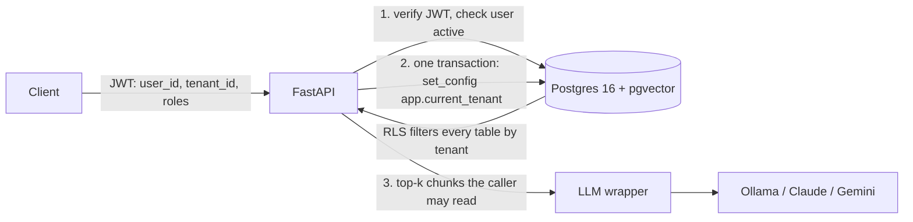

# Permission-aware multi-tenant RAG

A RAG backend where **a user can never retrieve, or cause an LLM to see, data they aren't allowed to read**.
Isolation is enforced in the database, not just in application code, and the test suite proves it.


## Stack
Python 3.12 · FastAPI · PostgreSQL 16 + pgvector · SQLAlchemy 2 + Alembic · PyJWT + argon2 ·
sentence-transformers (`all-MiniLM-L6-v2`, 384 dims, local) · LLM behind one wrapper
(Ollama / Claude / Gemini) · pytest + testcontainers · Docker Compose. No LangChain, no LlamaIndex.

## Architecture



## Security model

| Layer | Mechanism |
|---|---|
| Tenant isolation | Postgres Row-Level Security on every tenant table, `FORCE`d where the owner could otherwise bypass it. No tenant set means zero rows. |
| Least privilege | The app connects as `rag_app`: not owner, not superuser, `NOBYPASSRLS`, no DDL. Migrations run as `rag_owner`. |
| Tenant context | `set_config('app.current_tenant', ..., true)` (same as `SET LOCAL`) inside each request's single transaction, so it can't leak across pooled connections. |
| Cross-tenant links | Composite foreign keys `(tenant_id, id)` make it impossible to relate rows of different tenants, even through a bug. |
| Document access | Admin, creator, or an explicit `document_permissions` row, evaluated in SQL at query time and **never copied into chunks**. Revocation is immediate. |
| Existence hiding | A document you can't read returns 404, not 403. |
| Auth | argon2id passwords, short-lived HS256 JWTs (required `exp/iat/iss/sub`, algorithm pinned, roles validated), constant-time-ish login failures. |
| Audit log | Append-only: `UPDATE/DELETE/TRUNCATE` revoked and blocked by trigger even for the owner; RLS-scoped per tenant. Stores IDs, never question or answer text. |
| LLM safety | Retrieval happens before the LLM; no readable documents means no LLM call. Document text is escaped and framed as untrusted data. |

## Run it

```bash
cp .env.example .env          # then set JWT_SECRET and (optionally) change passwords
docker compose up -d --build  # db + migrations + API on http://127.0.0.1:8000
python -m scripts.seed_dev    # dev tenants: acme, globex (password: Passw0rd!dev)
```

Open http://127.0.0.1:8000/docs. Log in with
`{"tenant":"acme","email":"editor@acme.test","password":"Passw0rd!dev"}`.

| Endpoint | Purpose |
|---|---|
| `POST /auth/login` | Issue a JWT |
| `POST /documents` | Upload `.txt`/`.md`; ingested in a background task |
| `GET/DELETE /documents`, `/documents/{id}/permissions` | List, delete, grant, revoke |
| `POST /search` | Permission-aware vector search |
| `POST /ask` | Retrieve, then answer with `[n]` citations |

## Tests

```bash
pip install -r requirements-dev.txt
python -m pytest -q          # starts a disposable Postgres 16 + pgvector container
python -m pytest -m slow -q  # one end-to-end test with the real embedding model
```

The suite runs the real Alembic migration against a real Postgres and uses factory fixtures that create
isolated tenants per test. It asserts, among other things, that:
a tenant cannot read, update, delete or insert another tenant's rows; vector search never returns forbidden
chunks even when they are the best match; forged, expired, `alg=none` and cross-tenant tokens are rejected;
the audit log cannot be altered by the app role or the table owner.

## Known limitations
- Roles live in the JWT for its lifetime (15 min); deactivating a user takes effect immediately, role changes at next login.
- No rate limiting or account lockout yet; failed logins aren't audited.
- Only UTF-8 `.txt` / `.md` uploads; ingestion uses FastAPI background tasks (add Celery + Redis if uploads get slow).
- Small local models follow citation rules less reliably than hosted ones.
